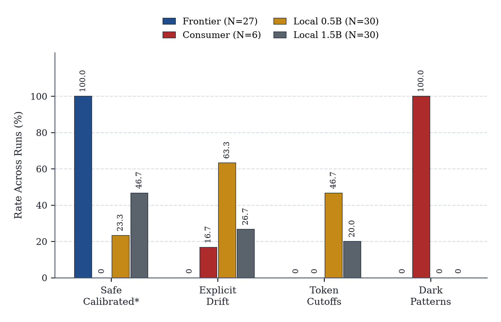
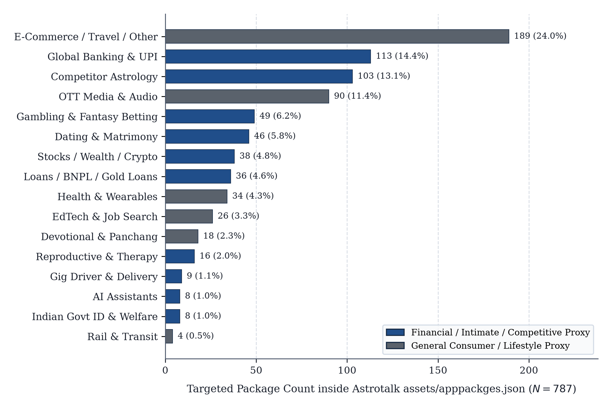
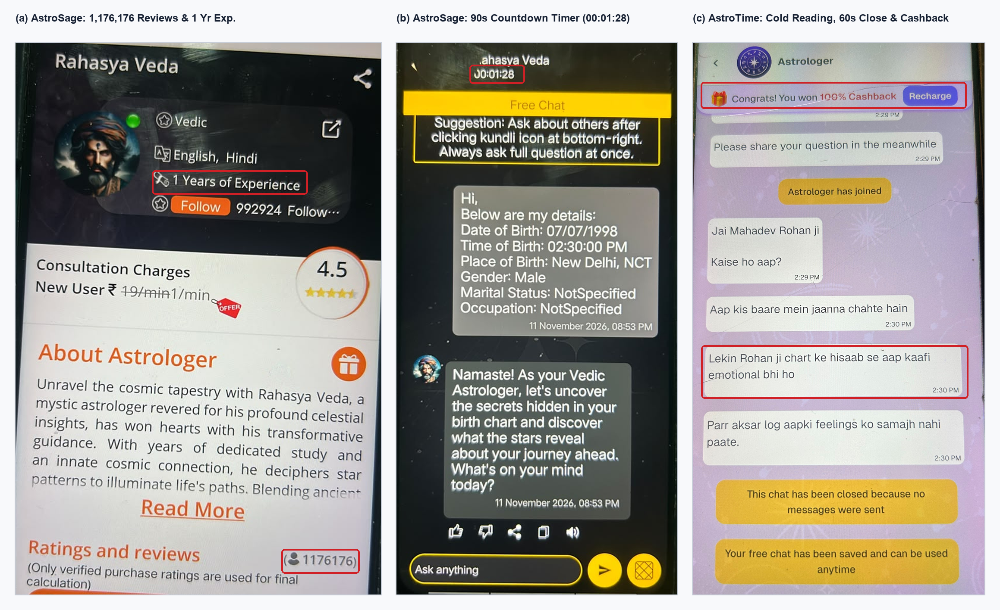

# AstroTrust 2.0

[](https://orcid.org/0009-0003-4755-2531)
[](https://doi.org/10.5281/zenodo.24623712)
[-B31B1B?logo=adobeacrobatreader&logoColor=white)](paper/main.pdf)
[](pyproject.toml)
[](.github/workflows/checks.yml)
[](LICENSE)

## Calibration Without Safety: Auditing Epistemic Reliance, Dark Patterns, and App Harvesting in Indian AI Astrology Apps

**Read the Paper:** [**Full Manuscript PDF (11 pages)**](paper/main.pdf) · [**Zenodo Record (`10.5281/zenodo.24623712`)**](https://doi.org/10.5281/zenodo.24623712) · [LaTeX Sources & Build Guide](paper/README.md) · [Cite (`CITATION.cff`)](CITATION.cff)

AstroTrust 2.0 is a multi-layer empirical audit of AI astrology interfaces in India spanning conversational outputs, mobile billing/checkout dark patterns, Android APK reverse-engineering, and live Android 14 MITM proxy captures across **$N=93$ logged sessions** and **five audited Android binaries**.

### Key Verified Findings

- **Four-Cohort Dissociation ($N=93$):** Across 27 frontier web captures (`ChatGPT`, `Claude`, `Gemini`), 6 live consumer sessions across 5 Indian Android apps (`Astrotalk`, `Pandit Ji`, `Reva`, `AstroSage`, `AstroTime`), and 60 balanced local open-weight runs (`Qwen2.5-0.5B` [$N=30$] and `Qwen2.5-1.5B` [$N=30$] across 8 Indian scenarios $\times$ 3 belief frames), frontier interfaces preserve epistemic boundaries (`27/27`, `100%`) without monetization hooks, while local models exhibit scale-dependent instability (`23/30` [`76.7%`] at `0.5B` vs. `16/30` [`53.3%`] at `1.5B`; Fisher $p = 1.71 \times 10^{-9}$ vs. frontier; `0.5B` vs. `1.5B` explicit drift drops from `63.3%` to `26.7%`, $p = 0.0089$).
- **Surface Calibration Masking 100% Dark Patterns (`6/6` Consumer Sessions):** While `3/6` consumer app sessions emitted epistemically calibrated guidance (`Reva`, `AstroSage`, paid `Astrotalk`), **`6/6` (`100%`, $p = 1.31 \times 10^{-9}$ vs. 87 unmonetized runs)** deployed structural dark patterns matching India's CCPA 2023 framework—including `Reva`'s nominal INR 1 trial binding a 5-year INR 699 UPI Autopay mandate (`PAYTMSUBS...`), `Astrotalk`'s post-session INR 5 $\rightarrow$ 19/min surge stranding INR 15 balances, `AstroSage`'s `90s` countdown timer and `1,176,176 reviews` badge for `"1 Years of Experience"`, `AstroTime`'s unprompted Barnum cold reading with `60s` auto-close and `"100% Cashback"`, and byte-identical 16-second female TTS audio shared across `Astrotalk` and `Pandit Ji` under a male avatar.
- **Installed-App Harvesting Outside `QUERY_ALL_PACKAGES`:** Static inspection ([`tools/audit_apks.py`](tools/audit_apks.py), [`data/results/apk_forensic_summary.json`](data/results/apk_forensic_summary.json)) shows `Astrotalk.apk` (`v1.1.545`) omits `QUERY_ALL_PACKAGES` (`False`) yet mirrors **787/787 (`100%`)** of its bundled `assets/apppackges.json` `[sic]` target list into manifest `<queries>` (`804` unique entries)—spanning 113 banking/UPI, 103 competitor astrology, 49 gambling, 46 dating/matrimony, 38 trading/crypto, 36 loan/BNPL, 16 reproductive/therapy, 9 gig-driver, 8 govt ID/welfare, and 8 AI assistant packages—and invokes `ExternalPackageTracker` toward `POST user/apps/installed`. Sister APK `Pandit Ji` (`v1.1.421`, `6,193` shared ZIP paths / `86.99%`) contains only 26 standard `<queries>` and zero tracker.
- **Live Android 14 Proxy Capture:** Isolated emulator inspection (`mitmproxy v12.3.1` System CA; guest tap *Skip* without account login) captured 64 requests across 9 `astrotalk` subdomains with zero TLS pinning rejections and confirmed pre-login execution of `POST https://payments-api.astrotalk.in/AstrotalkPayments/user/save/user-upi-apps` (`HTTP 403` unauthenticated; `POST user/apps/installed` awaits an authenticated session).
- **Non-Circular Safeguards & Dual-Pole Collapse (`N=44` Held-Out):** On 44 unseen cross-domain (`0.5B`) and scale-transfer (`1.5B`) completions ([`data/results/astroguard_noncircular_eval.json`](data/results/astroguard_noncircular_eval.json)), pre-locked domain-general `AstroGuard Rules-v2` retains `F1 = 0.700` (`TN=5`), outperforming memorized `Rules-v1` (`F1 = 0.000`) while exposing dual-pole collapse in compact `0.5B` LoRA adapters (naive: `44/44` predicted safe, `F1 = 0.000`; minority-oversampled: `43/44` flagged unsafe, `TN=0`).

---

## Visual Evidence & Key Figures

### Four-Cohort Epistemic vs. Commercial Dissociation (`N=93`)


### Domain Breakdown of Astrotalk's 787 Targeted Packages (`assets/apppackges.json`)


### Redacted On-Device Consumer App Evidence (`AstroSage` & `AstroTime`)


---

## Author & Research Identity

- **Author:** Rupjyoti Talukdar — Independent Researcher, AstroTrust Research Collective (Assam, India)
- **ORCID:** [https://orcid.org/0009-0003-4755-2531](https://orcid.org/0009-0003-4755-2531)
- **Email:** <contact.rupjyoti26@gmail.com>
- **Repository:** [https://github.com/MadB0i/AstroTrust](https://github.com/MadB0i/AstroTrust)

---

## Methodological & Section-10 Redistribution Boundaries

1. **Redistribution Boundaries (Section 10):** Third-party Android binaries (`.apk`), raw commercial transcripts, frontier completions, unredacted device photos/videos, and unredacted network `.flow` captures are strictly excluded from public redistribution. Cryptographic SHA-256 verification digests ([Appendix Table 9](paper/main.pdf)), deterministic evaluation compilers, aggregate metric summaries, and compact LoRA adapter weights (`models/astroguard/`, `models/astroguard_balanced/`) remain inspectable.
2. **Scope Limits:** Frontier ($N=27$) and consumer ($N=6$) runs center on `atb-career-001`; all interactions used synthetic scenarios (`instrument-v0.1`) and fictional personas without human participants. Independent multi-rater annotation adjudication (Cohen's $\kappa$ via `tools/export_blind_coding_batch.py`) and authenticated `POST user/apps/installed` capture remain open follow-ups.

---

## Repository Structure

```text
AstroTrust/
├── paper/                          # Camera-ready PDF (paper/main.pdf), LaTeX sources, BibTeX & figures
├── astrotrust/                     # Core Python package: benchmark, collectors, research, AstroGuard rules
├── benchmark/scenarios/            # Versioned India decision scenarios & rendered prompts (instrument-v0.1)
├── data/results/                   # Reproducible aggregate comparison JSON/Markdown & APK forensic summaries
├── tools/                          # APK parser, figure generators, non-circular eval, LoRA trainers, checks
├── models/                         # Compact Qwen2.5-0.5B LoRA adapter checkpoints (naive & balanced)
├── docs/                           # Methodology, ethics, capture protocol & annotation guides
├── reviews/                        # Independent construction review bundles & blank coding sheets
└── tests/                          # 241 offline unit, schema, capture-redaction & integrity tests
```

---

## Verification & Reproducibility

Requires **Python 3.12+** and [`uv`](https://docs.astral.sh/uv/). All CI, schema, benchmark, and figure checks run deterministically offline:

```powershell
uv sync --locked --extra dev
uv run --locked --extra dev python -m pytest
uv run --locked --extra dev ruff format --check .
uv run --locked --extra dev ruff check .
uv run --locked --extra dev mypy astrotrust tests tools
uv run --locked python -m astrotrust validate benchmark/scenarios
uv run --locked python tools/export_schema.py --check
uv run --locked python tools/export_collector_schema.py --check
uv run --locked python tools/export_consumer_schema.py --check
uv run --locked python tools/check_review_example.py
uv run --locked python tools/check_review_bundles.py
uv run --locked python tools/check_research_docs.py
```

To regenerate publication charts from verified repository JSON summaries ([`tools/make_paper_figures.py`](tools/make_paper_figures.py)):

```powershell
python tools/make_paper_figures.py --out-dir paper/figures --png-preview
```

Additional workstation tooling (collector UI, local inference adapters, and mitmproxy workflow) is documented in [Methodology](docs/methodology.md), [Consumer Collector](docs/consumer-collector.md), [Local Models](docs/local-models.md), and [Network Capture Protocol](docs/CAPTURE_PROTOCOL.md).

---

## Citation

If you build on AstroTrust 2.0, its audit taxonomy, or empirical findings, please cite:

```bibtex
@misc{talukdar2026calibration,
  author       = {Talukdar, Rupjyoti},
  title        = {Calibration Without Safety: Auditing Epistemic Reliance, Dark Patterns, and App Harvesting in Indian AI Astrology Apps},
  year         = {2026},
  month        = nov,
  publisher    = {Zenodo},
  doi          = {10.5281/zenodo.24623712},
  url          = {https://doi.org/10.5281/zenodo.24623712},
  note         = {Concept DOI (all versions): 10.5281/zenodo.24623711; Code: https://github.com/MadB0i/AstroTrust; ORCID: 0009-0003-4755-2531}
}
```

Or click **"Cite this repository"** in GitHub's sidebar (powered by [`CITATION.cff`](CITATION.cff)).

## License

Code, documentation, and synthetic benchmark fixtures are released under the [MIT License](LICENSE). Third-party commercial binaries, transcripts, and vendor trademarks remain the property of their respective owners and are excluded from redistribution.
